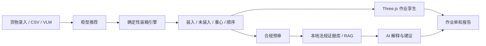

# 05_TECH_ARCHITECTURE

本文用途：用答辩能听懂的方式说明“甬柜易算”的技术架构，重点讲清楚前端、后端、装箱引擎、AI、RAG、3D 和报告导出的分工。

## 架构总览

甬柜易算可以理解为“三层 + 两类智能能力”：

1. **交互层**：Web 工作台和小程序/现场端思路，承接录入、推荐、3D、合规、报告。
2. **服务层**：Node.js / Express 后端，提供货物、柜型、装箱、VLM、合规、法规检索等接口。
3. **算法与数据层**：装箱引擎、柜型数据、货物数据、法规证据库、导出文件。
4. **确定性算法能力**：负责物理坐标、碰撞、重心、LIFO、装入/未装入。
5. **AI 辅助能力**：负责拍照识别、解释、法规溯源、报告建议和语义表达。

## 前端

前端位于 `web-dashboard/src/`，使用 React、Vite、Three.js 和 lucide-react。页面围绕工作台、货物录入、柜型推荐、3D 作业孪生、合规预审、报告导出组织。

前端不是只展示静态原型，而是通过接口调用后端：

- `/api/packing/generate` 生成装箱方案。
- `/api/packing/compliance-check-sync` 调用合规审计。
- `/api/vlm/recognize-cargo` 调用 VLM 识别货物。
- `/api/compliance/*` 获取法规证据。

前端同时承担用户体验边界：外部 AI 失败时显示真实失败/降级，不把失败伪装成成功。

## 后端

后端位于 `backend/`，主要技术栈是 Node.js、Express、MySQL 相关依赖和服务层模块。后端路由包括货物、柜型、装箱、合规、VLM、港口资料等。

后端的价值是把前端动作连接到真实服务：货物管理、柜型列表、装箱生成、合规检查、法规证据检索、VLM 识别等。最新后端真实 API 检查为 27/27 通过。

## 装箱引擎

装箱引擎负责把货物和柜型约束转成可执行装箱结果。答辩中应强调：

- 物理坐标由确定性算法计算。
- 碰撞、尺寸、重量、重心、顺序、可达性属于硬规则。
- 系统会保留未装入结果，不强行美化为全部装入。
- 真实结果为 221 件已装入、0 件未装货物。

可以提及 FastBlock、分层装箱、批量同 SKU 处理等机制，但不要把技术页讲成代码说明书。

## Three.js 作业孪生

Three.js 把装箱算法结果变成工人能看懂的现场作业画面。它不是单纯动画，而是基于装箱结果展示货物块、路径、目标位、门端方向、视角切换和算法依据。

3D 页面应在 PPT 中作为技术高潮页讲：算法不只给出坐标，还要让现场知道“下一件货放哪里、怎么走、为什么这样放”。

## VLM

VLM 使用 Qwen/Qwen3-VL-32B-Instruct。它在链路中的角色是把货物照片转成待确认字段，例如包装类型、木包装风险、尺寸重量相关提示。它降低录入门槛，但不替代人工确认。

答辩中应表达为“拍照识别 + 人工确认”，不要表达为“AI 自动完成所有录入且完全准确”。

## DeepSeek

DeepSeek 模型口径为 `deepseek-v4-flash`。它主要用于合规解释、报告建议和审计语义表达。真实测试中 DeepSeek 返回 本地规则 WARNING / AI建议 PASS / 人工复核独立，来源为 AI。

关键边界：DeepSeek 不决定装箱物理坐标，不替代装箱引擎；物理规则由确定性算法和本地规则先行保证。

## RAG

RAG 使用本地法规证据库进行检索增强，再由 AI 解释。当前关键词 9/9 命中，覆盖 SOLAS VGM、CTU、LIFO、重心、IPPC、单证一致性、危险品等。

答辩中可以说“本地法规证据库 + RAG 检索 + AI 解释”，不要说“实时联网国标检索”。

## 报告导出

报告导出当前支持 HTML、CSV、JSON，均由前端真实生成并下载。它的答辩价值是把装柜结果、合规结论和证据链从“页面展示”变成“可交付、可复核材料”。

不应宣称已有 PDF、Excel、ZIP 后端导出，除非后续有新证据。

## 数据流

## AI 与确定性算法边界

| 决策类型 | 负责方 | 说明 |
|---|---|---|
| 坐标、碰撞、重心、装入/未装入 | 确定性算法 | 直接影响物理装载，必须可复核 |
| LIFO、堆叠、可达、承压 | 确定性规则与装箱引擎 | 属于硬约束或约束校验 |
| 图片识别、字段建议 | VLM | 输出待确认字段 |
| 法规证据检索 | RAG | 返回可追溯来源 |
| 合规解释、整改建议、报告语言 | DeepSeek / AI | 帮助理解，不替代硬规则 |
| 最终复核 | 人工 | 保留审核和确认权 |
