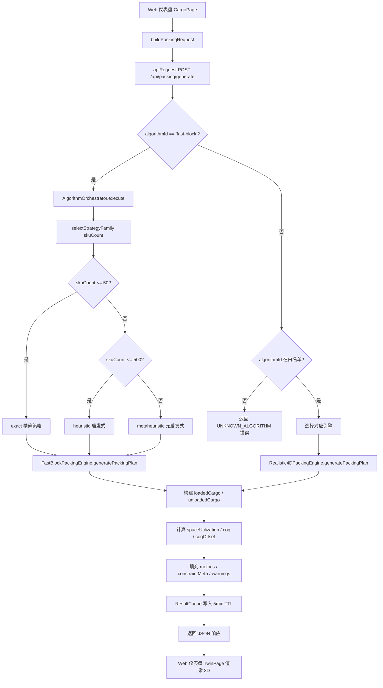
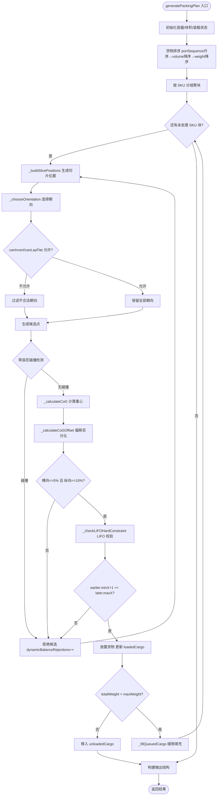
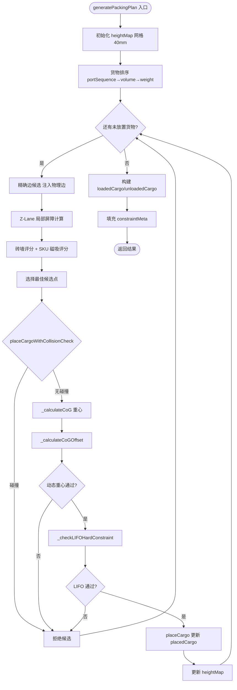
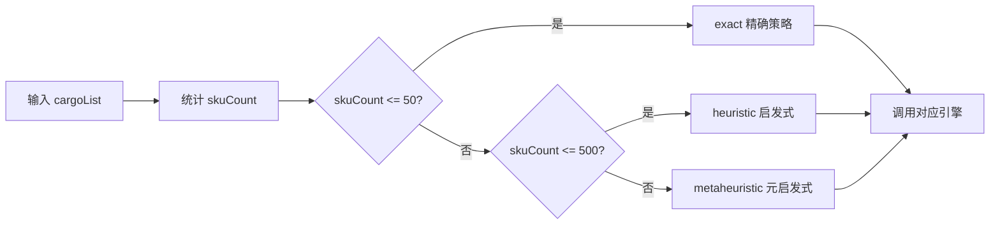
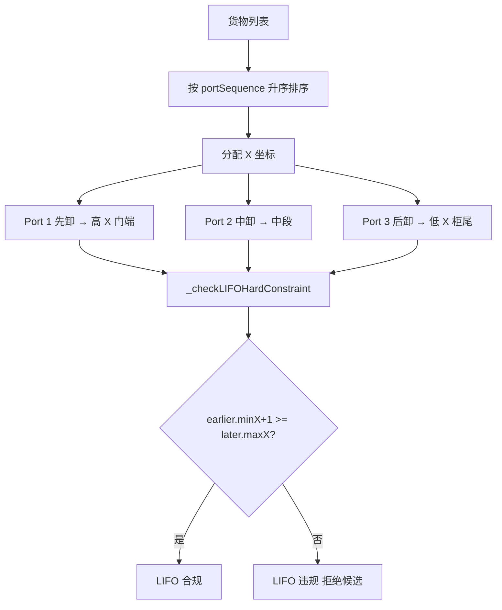
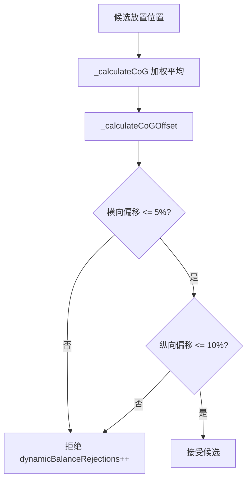
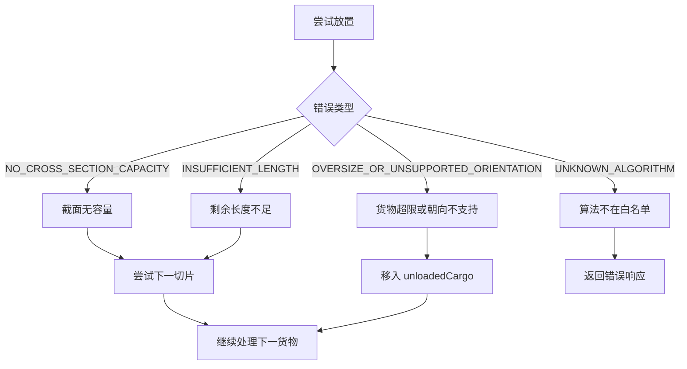
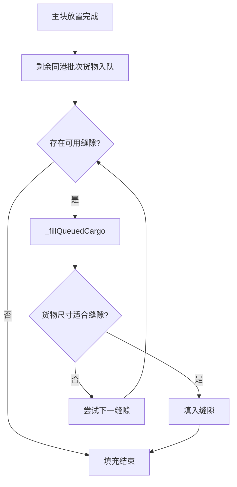

# 算法流程文档 (ALGORITHM_FLOW)

> 生成时间：2026-07-11
> 调查基线：分支 `codex/sol`，HEAD `ef47171694c44feb086d4875a95732f79ed229f9`

---

## 1. 端到端生产链路流程

### 1.1 Mermaid 流程图（可编辑源代码）



### 1.2 关键代码位置

| 步骤 | 代码位置 |
|---|---|
| 前端请求构造 | [web-dashboard/src/services/packingApi.js:7](../../web-dashboard/src/services/packingApi.js) |
| 后端路由入口 | [backend/routes/packing.js](../../backend/routes/packing.js) |
| 白名单校验 | [backend/services/AlgorithmOrchestrator.js:91-99](../../backend/services/AlgorithmOrchestrator.js) |
| 策略族选择 | [backend/services/AlgorithmOrchestrator.js:64-72](../../backend/services/AlgorithmOrchestrator.js) |
| FastBlock 主流程 | [backend/services/FastBlockPackingEngine.js:36](../../backend/services/FastBlockPackingEngine.js) |
| Realistic4D 主流程 | [backend/services/Realistic4DPackingEngine.js](../../backend/services/Realistic4DPackingEngine.js) |
| 缓存写入 | [backend/services/ResultCache.js](../../backend/services/ResultCache.js) |

---

## 2. FastBlockPackingEngine 内部流程

### 2.1 Mermaid 流程图



### 2.2 关键步骤说明

| 步骤 | 方法 | 代码位置 |
|---|---|---|
| 初始化 | `generatePackingPlan` 开头 | [backend/services/FastBlockPackingEngine.js:36](../../backend/services/FastBlockPackingEngine.js) |
| 货物排序 | 内部 sort | FastBlockPackingEngine.js |
| 切片生成 | `_buildSlicePositions` | FastBlockPackingEngine.js |
| 朝向选择 | `_chooseOrientation` | FastBlockPackingEngine.js |
| 碰撞检测 | `placeCargoWithCollisionCheck`（Realistic4D）/ 零容忍检查（FastBlock） | Realistic4DPackingEngine.js |
| 重心计算 | `_calculateCoG` | Realistic4DPackingEngine.js |
| 重心偏移 | `_calculateCoGOffset` | Realistic4DPackingEngine.js |
| LIFO 校验 | `_checkLIFOHardConstraint` | Realistic4DPackingEngine.js |
| 缝隙填充 | `_fillQueuedCargo` | FastBlockPackingEngine.js |

---

## 3. Realistic4DPackingEngine 内部流程

### 3.1 Mermaid 流程图



### 3.2 Realistic4D 评分机制

| 评分项 | 权重 | 说明 |
|---|---|---|
| 砖墙评分（X 轴最小化） | 高 | 激进压缩 X 方向，强制紧凑 |
| SKU 磁吸 | 50000（封顶 5000） | 同 SKU 聚集奖励 |
| 地面优先（Y=0） | 高 | 优先贴地放置 |
| 接触面 | 中 | 底部接触地面或下层顶面 |

---

## 4. 调度器策略选择流程

### 4.1 Mermaid 流程图



代码位置：[backend/services/AlgorithmOrchestrator.js:64-72](../../backend/services/AlgorithmOrchestrator.js)

---

## 5. 缓存命中流程

### 5.1 Mermaid 流程图

```mermaid
flowchart TD
    Req[收到请求] --> Key[计算缓存 key = hash(cargoList + container + options)]
    Key --> Lookup{ResultCache 命中?}
    Lookup -->|是| Hit[直接返回缓存结果 <50ms]
    Lookup -->|否| Miss[执行算法]
    Miss --> Write[写入缓存 TTL=5min]
    Write --> Return[返回结果]
```

代码位置：[backend/services/ResultCache.js](../../backend/services/ResultCache.js)

---

## 6. LIFO 卸货顺序流程

### 6.1 Mermaid 流程图



### 6.2 LIFO 校验逻辑

```
对任意两个 portSequence: earlier < later
要求: earlier 货物的 minX + 1 >= later 货物的 maxX
```

即先卸货物（earlier）的最里侧（低 X 端）必须不比后卸货物（later）的最外侧（高 X 端）更靠门。这样卸货时不会因后卸货物挡住先卸货物而需要倒箱。

代码位置：Realistic4DPackingEngine `_checkLIFOHardConstraint`

---

## 7. 重心校验流程

### 7.1 Mermaid 流程图



### 7.2 偏移百分比公式

```
横向百分比 = |cog.z - width/2| / (width/2) * 100
纵向百分比 = |cog.x - length/2| / (length/2) * 100
```

代码位置：[backend/services/FastBlockPackingEngine.js:14-15](../../backend/services/FastBlockPackingEngine.js)（阈值常量）

---

## 8. 失败处理流程

### 8.1 Mermaid 流程图



---

## 9. 多目的港排序流程

### 9.1 Mermaid 流程图


排序键（VERIFIED）：`portSequence` 升序 → `volume` 降序 → `weight` 降序

---

## 10. 缝隙填充流程

### 10.1 Mermaid 流程图



代码位置：FastBlockPackingEngine `_fillQueuedCargo`

---

## 11. 流程边界声明

- 以上流程基于代码静态分析，未包含运行时分支的全部细节
- FastBlock 与 Realistic4D 在候选点生成、评分机制上存在差异，但输出结构一致
- 缓存层对算法流程透明，命中缓存时跳过算法执行
- 失败处理不会中断整个流程，未放置货物统一进入 `unloadedCargo`
