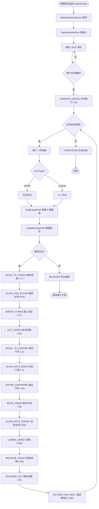
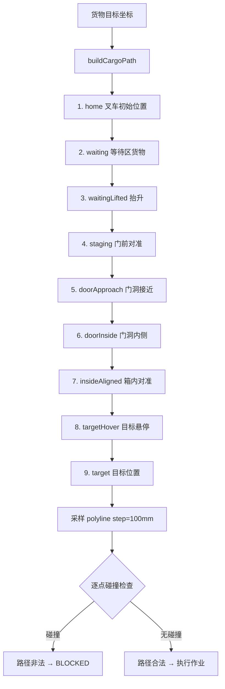
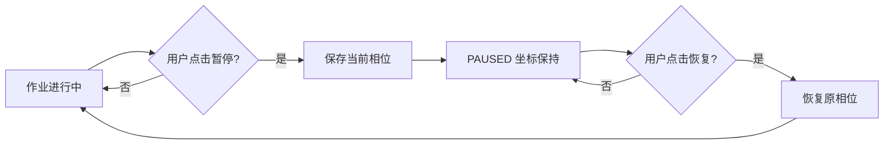

# 3D 作业流程文档 (THREE_D_OPERATION_FLOW)

> 生成时间：2026-07-11
> 调查基线：分支 `codex/sol`，HEAD `ef47171694c44feb086d4875a95732f79ed229f9`
> 代码位置：[web-dashboard/src/three/operation/operationMachine.js](../../web-dashboard/src/three/operation/operationMachine.js) 与 [web-dashboard/src/three/operation/geometry.js](../../web-dashboard/src/three/operation/geometry.js)

---

## 1. 作业流程概览

### 1.1 端到端流程

```
[装箱算法返回 loadedCargo]
  → buildOperationQueue 排序（x→y→z→loadingIndex 升序）
  → OperationMachine 初始化（IDLE）
  → 用户点击播放
  → OPENING_DOORS（打开箱门）
  → 逐件货物执行 14 相位作业
  → COMPLETED（全部完成）
```

### 1.2 单件货物作业流程

```
MOVE_TO_CARGO → ALIGN_FOR_PICKUP → INSERT_FORKS → LIFT_CARGO
  → MOVE_TO_STAGING → ALIGN_WITH_DOOR → ENTER_CONTAINER
  → MOVE_INSIDE → ALIGN_WITH_TARGET → LOWER_CARGO
  → RELEASE_CARGO → REVERSE_OUT → RETURN_FOR_NEXT
```

---

## 2. Mermaid 流程图（可编辑源代码）

### 2.1 主流程



### 2.2 路径构建与校验流程



### 2.3 暂停/恢复流程



---

## 3. 作业队列排序

### 3.1 buildOperationQueue（VERIFIED）

代码位置：[web-dashboard/src/three/operation/operationMachine.js:61-67](../../web-dashboard/src/three/operation/operationMachine.js)

```js
export function buildOperationQueue(loadedCargo = []) {
  return loadedCargo.map((cargo, sourceIndex) => ({ ...cargo, sourceIndex }))
    .sort((a, b) => Number(a.x) - Number(b.x)
      || Number(a.y) - Number(b.y)
      || Number(a.z) - Number(b.z)
      || Number(a.loadingIndex || a.sourceIndex) - Number(b.loadingIndex || b.sourceIndex));
}
```

### 3.2 排序规则

```
按 x 升序 → y 升序 → z 升序 → loadingIndex 升序
```

- **深区优先**：低 X（柜尾）先装，避免挡住后续货物
- **底层优先**：低 Y（地面）先装，避免悬空
- **同位置按算法顺序**：loadingIndex 保证与算法一致

### 3.3 排序示例

| 货物 | x | y | z | loadingIndex | 排序后 |
|---|---|---|---|---|---|
| A | 1000 | 0 | 500 | 2 | 3 |
| B | 500 | 0 | 500 | 1 | 1 |
| C | 500 | 500 | 500 | 3 | 2 |

排序结果：B → C → A

---

## 4. 9 段路径详解

### 4.1 路径段定义（VERIFIED）

| 段 | 名称 | 坐标说明 | 对应相位 |
|---|---|---|---|
| 1 | home | 叉车初始位置（waitingZone 内） | IDLE |
| 2 | waiting | 等待区货物位置 | MOVE_TO_CARGO |
| 3 | waitingLifted | 等待区抬升后（货物 + 目标层高 Y） | LIFT_CARGO |
| 4 | staging | 门前对准区（doorPlaneX 附近） | MOVE_TO_STAGING / ALIGN_WITH_DOOR |
| 5 | doorApproach | 门洞接近（doorOpening 入口） | ENTER_CONTAINER |
| 6 | doorInside | 门洞内侧（进入箱内） | ENTER_CONTAINER → MOVE_INSIDE |
| 7 | insideAligned | 箱内对准（目标 Z 坐标） | MOVE_INSIDE → ALIGN_WITH_TARGET |
| 8 | targetHover | 目标悬停（目标 X/Y/Z 上方） | LOWER_CARGO |
| 9 | target | 目标位置（最终放置点） | RELEASE_CARGO |

### 4.2 路径构建

代码位置：[web-dashboard/src/three/operation/geometry.js](../../web-dashboard/src/three/operation/geometry.js)

`buildCargoPath(cargo, container, options)`：

1. 从 loadedCargo 获取货物的目标坐标 (x, y, z)
2. 根据 doorPlaneX 计算门端入口
3. 根据 doorOpening 计算门洞范围
4. 根据 waitingZone 计算起点
5. 串联 9 段路径点

### 4.3 路径示例（40HQ，货物目标 (3000, 1000, 500)）

```
段1 home:          (15232, 0, 1176)      // 等待区中部
段2 waiting:       (14232, 0, 500)       // 货物在等待区
段3 waitingLifted: (14232, 1000, 500)    // 抬升到目标层
段4 staging:       (12032, 1000, 500)    // 门前
段5 doorApproach:  (12032, 1000, 500)    // 门洞入口
段6 doorInside:    (11500, 1000, 500)    // 进入箱内
段7 insideAligned: (3000, 1000, 500)     // 对准目标 Z
段8 targetHover:   (3000, 1000, 500)     // 目标上方
段9 target:        (3000, 1000, 500)     // 放置
```

---

## 5. 碰撞校验流程

### 5.1 validateCargoPath（VERIFIED）

代码位置：[web-dashboard/src/three/operation/geometry.js](../../web-dashboard/src/three/operation/geometry.js)

```
FUNCTION validateCargoPath(path, container, placedCargo)
    samples = samplePolyline(path, step=100mm)
    FOR EACH point IN samples
        IF collideWithWalls(point) THEN RETURN INVALID
        IF collideWithDoor(point) THEN RETURN INVALID
        IF collideWithPlaced(point, placedCargo) THEN RETURN INVALID
    END FOR
    RETURN VALID
END FUNCTION
```

### 5.2 碰撞检查对象

| 对象 | 检查内容 |
|---|---|
| 前壁 | point.x >= 0 + clearance.bottom |
| 地板 | point.y >= 0 + clearance.bottom |
| 顶板 | point.y + cargo.h <= height - clearance.top |
| 侧壁 | point.z >= 0 + clearance.side AND point.z + cargo.w <= width - clearance.side |
| 门框 | 门端附近（point.x > doorPlaneX - threshold）时检查 doorOpening 范围 |
| 已装货物 | AABB 与所有 placedCargo 不相交（tolerance=2mm） |

### 5.3 校验失败处理

- 校验失败 → 相位进入 BLOCKED
- 货物标记为不可放置
- 用户可跳过该货物或调整方案

---

## 6. 相位与路径段映射

### 6.1 完整映射表

| 相位 | 路径段 | 动作 |
|---|---|---|
| IDLE | home | 叉车在初始位置 |
| OPENING_DOORS | - | 打开箱门 |
| MOVE_TO_CARGO | home → waiting | 叉车驶向货物 |
| ALIGN_FOR_PICKUP | waiting | 对准货物 |
| INSERT_FORKS | waiting | 货叉插入 |
| LIFT_CARGO | waiting → waitingLifted | 抬升货物 |
| MOVE_TO_STAGING | waitingLifted → staging | 移至门前 |
| ALIGN_WITH_DOOR | staging | 对准门洞 Z |
| ENTER_CONTAINER | staging → doorInside | 通过门洞 |
| MOVE_INSIDE | doorInside → insideAligned | 箱内行进 |
| ALIGN_WITH_TARGET | insideAligned | 对准目标坐标 |
| LOWER_CARGO | insideAligned → targetHover | 货叉下降 |
| RELEASE_CARGO | targetHover → target | 抽出货叉 |
| REVERSE_OUT | target → doorInside → staging | 倒车出箱 |
| RETURN_FOR_NEXT | staging → home | 返回等待区 |

---

## 7. actor 类型流程

### 7.1 actorType 决定（VERIFIED）

```
actorType = cargo.handlingMethod
```

| handlingMethod | actorType | 渲染模型 |
|---|---|---|
| manual | 人工 actor | createManualWorker.js（10 部件） |
| forklift | 叉车 | createIndustrialForklift.js（34 部件） |

### 7.2 人工作业 vs 叉车作业

两者走相同的 18 相位状态机，差异：

| 维度 | 叉车作业 | 人工作业 |
|---|---|---|
| 渲染模型 | 叉车（34 部件） | 工人（10 部件） |
| 货叉 | 有 | 无（徒手搬运） |
| 步态 | 无 | gait = sin(progress * 4π) |
| 速度 | 较快 | 较慢（视觉上） |

### 7.3 workerPoseFromForklift（VERIFIED）

当需要工人跟随叉车时：

```
工人位置 = 叉车位置 - 380mm（X 偏移）
gait = sin(progress * 4π)
```

- 工人位于叉车后方 380mm
- 步态动画基于作业进度（progress 0→1）

---

## 8. 倍速控制

### 8.1 倍速选项（VERIFIED）

| 平台 | 倍速选项 |
|---|---|
| Web | 0.5 / 1 / 2 / 4× |
| 小程序 | 1 / 4 / 10 / 30× |

### 8.2 倍速对时长的影响

单件货物基准时长（1×）：21.2 秒

| 倍速 | 单件时长 | 100 件总时长 |
|---|---|---|
| 0.5×（Web） | 42.4s | 70.7 分钟 |
| 1× | 21.2s | 35.3 分钟 |
| 2×（Web） | 10.6s | 17.7 分钟 |
| 4×（Web） | 5.3s | 8.8 分钟 |
| 10×（小程序） | 2.12s | 3.5 分钟 |
| 30×（小程序） | 0.71s | 1.2 分钟 |

### 8.3 倍速实现

- 倍速通过调整 tick 的 deltaMs 实现
- `tick(deltaMs * speedMultiplier)` 推进相位
- 相位转移条件不变，仅时间推进加快

---

## 9. 队列筛选与分组

### 9.1 队列筛选（VERIFIED）

代码位置：[web-dashboard/src/three/presentation/operationFilters.js](../../web-dashboard/src/three/presentation/operationFilters.js)

7 维筛选：

| # | 维度 | 说明 |
|---|---|---|
| 1 | sku | SKU 编码 |
| 2 | batch | 批次 |
| 3 | port | 目的港 |
| 4 | sequence | 顺序 |
| 5 | actor | 搬运者（manual/forklift） |
| 6 | state | 作业状态 |
| 7 | risk | 风险等级 |

### 9.2 队列分组（VERIFIED）

代码位置：[web-dashboard/src/three/presentation/queueGroups.js](../../web-dashboard/src/three/presentation/queueGroups.js)

- 分组键：`sku::batch::port::handling::packaging`
- 合并连续相同项：相邻货物若分组键相同，合并为一个组

### 9.3 分组示例

原始队列：

| 货物 | sku | batch | port | handling | packaging |
|---|---|---|---|---|---|
| A | FAN-001 | B01 | Ningbo | forklift | carton |
| B | FAN-001 | B01 | Ningbo | forklift | carton |
| C | LAMP-002 | B02 | Shanghai | manual | carton |

分组后：

| 组 | 货物 | 键 |
|---|---|---|
| 1 | A, B | FAN-001::B01::Ningbo::forklift::carton |
| 2 | C | LAMP-002::B02::Shanghai::manual::carton |

---

## 10. 剖切模式

### 10.1 review 模式（VERIFIED）

- 切换 shell 材质为透明（opacity 0.16）
- 用于查看箱内货物布局
- 不影响作业过程

### 10.2 剖切实现

- 集装箱外壳材质切换
- 货物材质不变
- 通过 createIndustrialContainer.js 的 review 剖切线框实现

---

## 11. InstancedMesh 批量渲染

### 11.1 已装货物渲染（VERIFIED）

- 使用 InstancedMesh 批量渲染已装货物
- 减少 draw call
- 每件货物一个 instance

### 11.2 优势

- 100 件货物从 100 次 draw call 降到 1 次
- 提升 WebGL 渲染性能
- 适用于大批量场景

---

## 12. 作业流程边界声明

- 作业流程是可视化的预设动画，不是真实叉车控制
- 相位时长是预设值，不反映真实作业时间
- 路径校验是静态 AABB 检查，不模拟动力学
- BLOCKED 仅在路径校验失败时触发，不处理运行时异常
- 倍速仅加快动画，不改变作业逻辑
- 人工与叉车作业走相同状态机，差异仅在渲染
