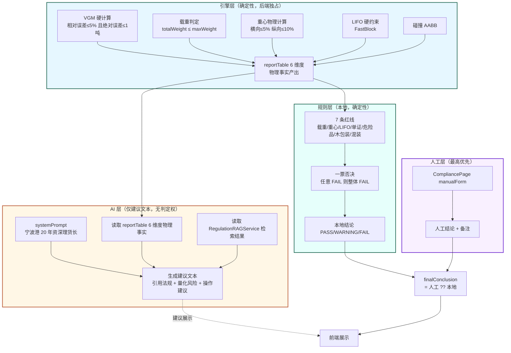
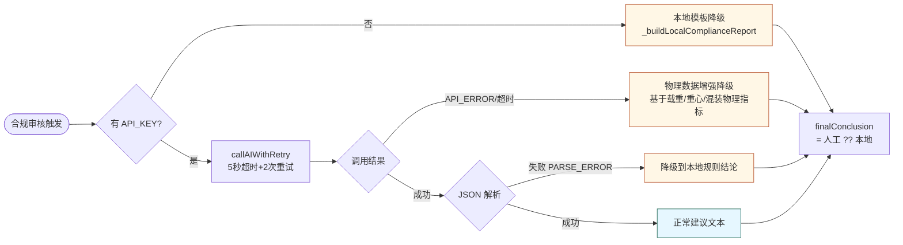
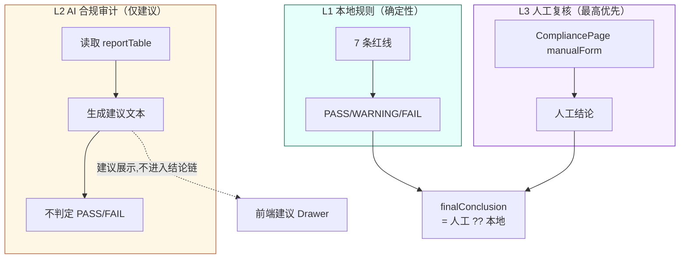
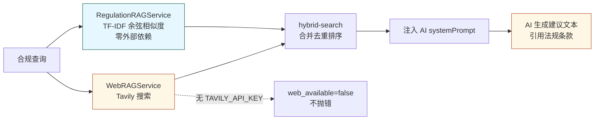

# AI 角色与边界 (AI_ROLE_AND_BOUNDARY)

> 生成时间：2026-07-11
> 适用版本：v3.2.0 → v4.0 零幻觉架构目标
> 核心原则：**AI 仅写建议文本，不判定 PASS/FAIL**
> 证据基线：[backend/services/AIComplianceService.js:6,49](file:///d:/cixing/3chuang/backend/services/AIComplianceService.js#L6)

---

## 1. AI 在系统中的角色定位

### 1.1 角色设定（VERIFIED）

证据：[backend/services/AIComplianceService.js:49](file:///d:/cixing/3chuang/backend/services/AIComplianceService.js#L49)

- **角色**："宁波港 20 年资深理货长"
- **任务**：基于后端已计算出的 reportTable 6 维度物理事实，写出人类可读的合规建议文本
- **能力边界**：仅文本生成，无判定权、无决策权、无回写权

### 1.2 顶层架构信条

> "引擎算物理，AI 判合规"
>
> —— [backend/services/AIComplianceService.js:6](file:///d:/cixing/3chuang/backend/services/AIComplianceService.js#L6)

这里的"判合规"指的是**写出合规建议文本**，而非**给出 PASS/FAIL 结论**。PASS/FAIL 由本地规则引擎与人工复核产出。

## 2. AI 做什么 / 不做什么

### 2.1 ✅ AI 做的事

| 能力 | 说明 | 证据 |
|---|---|---|
| 生成 6 维度建议文本 | 把 reportTable 物理事实翻译成理货长口吻的解释 | AIComplianceService systemPrompt |
| 引用法规条款 | 在建议文本中引用 ctu_code/gb40163/jtt1187/solas_vgm | RegulationRAGService 检索结果注入 prompt |
| 量化退路风险 | 引用行业数据锚定（查验率 60%、倒箱费 800-2000 元） | v3.1 行业数据锚定 |
| 给出操作建议 | 如"建议将重货下移、轻货上移以修正重心" | systemPrompt 指令 |
| 联网补充检索 | 通过 WebRAGService 调 Tavily 获取最新法规动态 | WebRAGService |

### 2.2 ❌ AI 不做的事

| 禁止项 | 原因 | 替代方案 |
|---|---|---|
| **判定 PASS/FAIL** | 架构边界，避免幻觉导致误判 | 本地规则引擎 + 人工复核 |
| **修改物理指标** | 物理指标由后端引擎确定性计算 | 引擎独占 |
| **覆盖本地规则结论** | 本地规则是确定性事实 | `finalConclusion` 优先人工→本地规则 |
| **静默覆盖 complianceHistory** | 历史轨迹必须保留 | 每次审核追加新版本 |
| **法规 PDF 原文联动** | NOT_FOUND，无 PDF 解析层 | 仅引用 JSON 结构化条款 |
| **法规页码高亮** | NOT_FOUND，无 PDF 渲染层 | 仅引用 section 编号 |
| **柜型推荐决策** | v37.1 起纯算法不调 AI | AlgorithmOrchestrator |

## 3. AI 边界架构图（Mermaid）

> 上图为可编辑 Mermaid 源码，复制到任何支持 Mermaid 的编辑器即可渲染。

## 4. AI 降级链（VERIFIED）

当 AI 不可用时，系统按以下顺序降级，**永不阻塞主流程**：

### 4.1 降级触发条件表

| 触发条件 | 降级路径 | 输出 | 证据 |
|---|---|---|---|
| 无 `AI_API_KEY` | 本地模板降级 | `_buildLocalComplianceReport` 结果 | AIComplianceService |
| `API_ERROR` / 超时 | 物理数据增强降级 | 基于载重/重心/混装物理指标的判定 | v3.2 High Availability |
| `PARSE_ERROR` | 降级到本地规则 | 本地规则结论 | AIComplianceService |

### 4.2 调用与重试参数

| 参数 | 值 | 证据 |
|---|---|---|
| 单次超时 | 5 秒 | `callAIWithRetry` |
| 重试次数 | 2 次 | v3.2 |
| 总耗时上限 | ≤ 10 秒 | v3.2 文档 |
| 智能预热 | `onReady` 后台静默加载 | v3.2 |
| 全链路日志 | 超时/重试/降级 可追溯 | v3.2 |

## 5. AI 与三层架构的关系

### 5.1 关键不变量

1. **AI 输出不进入 `finalConclusion` 链** —— AI 仅展示，不决策
2. **`finalConclusion` 优先级**：人工复核结论 ?? 本地规则结论
3. **`complianceHistory` 不可静默覆盖** —— 每次审核追加新版本
4. **物理指标不可被 AI 修改** —— 引擎独占计算权

## 6. AI 与法规检索的关系

- 法规检索结果**注入 AI prompt**，不直接进入 `finalConclusion`
- 即使 WebRAGService 不可用，本地 RegulationRAGService 仍可独立工作
- `cache_used=true` 标记允许 WebRAGService 返回缓存结果

## 7. v4.0 零幻觉架构目标

当前 v3.2 已落地以下 v4.0 边界：

| 边界 | v3.2 状态 | 证据 |
|---|---|---|
| AI 不判定 PASS/FAIL | ✅ 已落地 | `finalConclusion` 不含 AI 输出 |
| 物理指标引擎独占 | ✅ 已落地 | VGM/重心/LIFO 全部后端硬计算 |
| 法规引用可追溯 | ✅ 已落地 | RegulationRAGService 返回 docId+section |
| 降级链完整 | ✅ 已落地 | 3 级降级，永不阻塞 |
| 历史不可覆盖 | ✅ 已落地 | `complianceHistory` 追加模式 |

## 8. 测试覆盖（VERIFIED）

| 测试文件 | 覆盖点 | 证据 |
|---|---|---|
| backend/__tests__/unit/ai-recommend-container.test.js | AI 柜型推荐策略（v37.1 起纯算法） | [文件](file:///d:/cixing/3chuang/backend/__tests__/unit/ai-recommend-container.test.js) |
| backend/__tests__/unit/ai-semantic-cache-offline.test.js | 语义缓存离线降级 | [文件](file:///d:/cixing/3chuang/backend/__tests__/unit/ai-semantic-cache-offline.test.js) |
| backend/__tests__/unit/ai-strategy-explain.test.js | AI 策略解释 | [文件](file:///d:/cixing/3chuang/backend/__tests__/unit/ai-strategy-explain.test.js) |

## 9. 相关文档

- [COMPLIANCE_FACTS.md](./COMPLIANCE_FACTS.md) —— 合规事实总览
- [COMPLIANCE_RULE_MATRIX.md](./COMPLIANCE_RULE_MATRIX.md) —— 7 红线 × 6 维度矩阵
- [COMPLIANCE_EVIDENCE_FLOW.md](./COMPLIANCE_EVIDENCE_FLOW.md) —— 合规证据流
- [COMPLIANCE_LIMITATIONS.md](./COMPLIANCE_LIMITATIONS.md) —— 合规限制与边界声明
