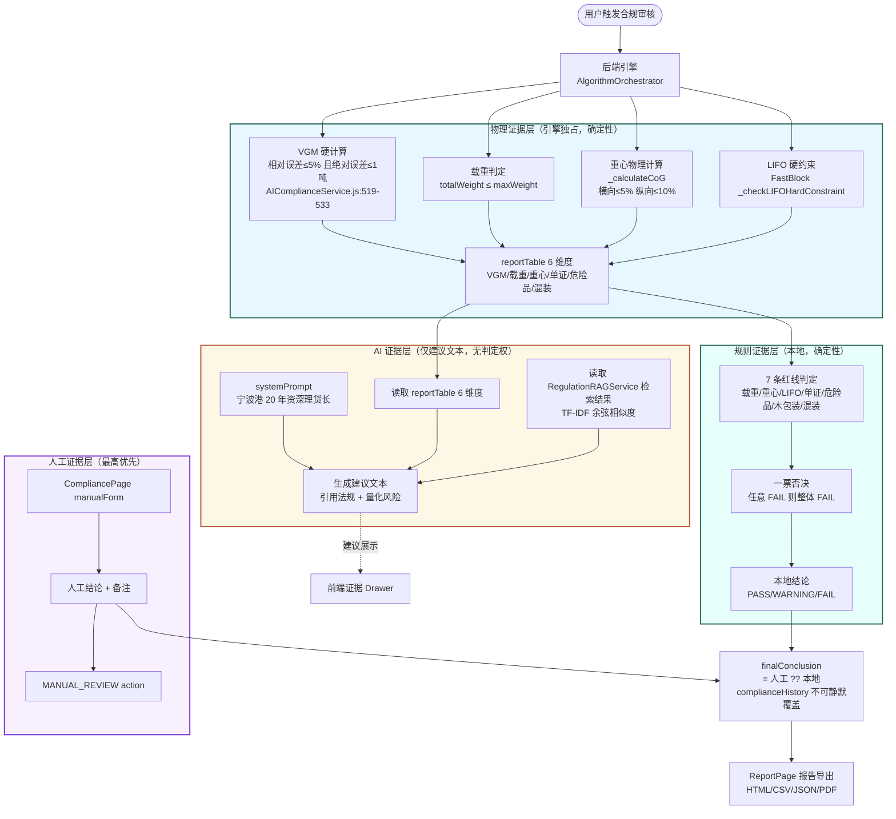
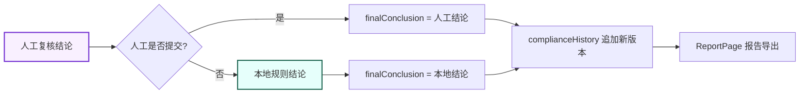
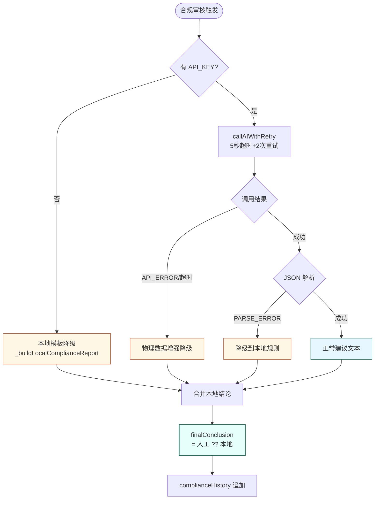
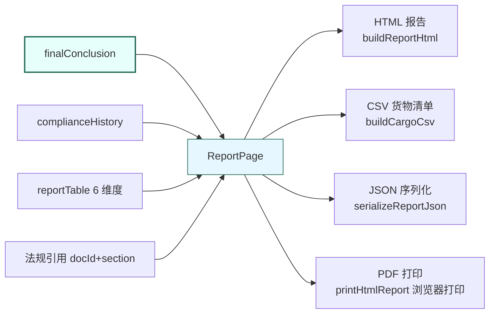

# 合规证据流 (COMPLIANCE_EVIDENCE_FLOW)

> 生成时间：2026-07-11
> 适用版本：v3.2.0（High Availability Upgrade）
> 文档目的：描述从"装箱方案产出"到"最终结论落地"的完整证据流，明确每一步证据的来源、形态与不可篡改性
> 证据基线：[backend/services/AIComplianceService.js](file:///d:/cixing/3chuang/backend/services/AIComplianceService.js)、[web-dashboard/src/pages/workflows/CompliancePage.jsx](file:///d:/cixing/3chuang/web-dashboard/src/pages/workflows/CompliancePage.jsx)

---

## 1. 证据流总览（Mermaid）



> 上图为可编辑 Mermaid 源码。

## 2. 四层证据来源

### 2.1 物理证据层（VERIFIED）

| 证据 | 计算入口 | 不可篡改性 | 证据 |
|---|---|---|---|
| VGM 重量 | 后端硬计算 | 引擎独占，AI 不可改 | [AIComplianceService.js:519-533](file:///d:/cixing/3chuang/backend/services/AIComplianceService.js#L519) |
| 载重比对 | `totalWeight vs maxWeight` | 引擎独占 | AIComplianceService `_checkWeight` |
| 重心坐标 | `_calculateCoG` | 引擎独占 | NingboPortSafetyEngine v25.0 |
| LIFO 顺序 | `_checkLIFOHardConstraint` | 引擎独占 | FastBlock |
| reportTable 6 维度 | 引擎聚合 | 引擎独占 | AIComplianceService |

**关键点**：所有物理证据均由后端确定性引擎计算，**AI 不可修改、不可覆盖**。

### 2.2 规则证据层（VERIFIED）

| 证据 | 来源 | 输出 | 证据 |
|---|---|---|---|
| 7 条红线判定 | `evaluate.js` / `_buildLocalComplianceReport` | 每条红线 PASS/WARNING/FAIL | AIComplianceService |
| 一票否决 | v3.0 红线机制 | 任意 FAIL → 整体 FAIL | AIComplianceService v3.0 |
| 本地结论 | 规则引擎聚合 | PASS/WARNING/FAIL | AIComplianceService |

### 2.3 AI 证据层（VERIFIED，仅建议）

| 证据 | 来源 | 输出 | 边界 |
|---|---|---|---|
| 6 维度建议文本 | AI 生成 | 人类可读的合规建议 | **不判定 PASS/FAIL** |
| 法规引用 | RegulationRAGService 检索 | docId + section | 仅引用 JSON 结构化条款 |
| 量化风险 | 行业数据锚定 | 查验率 60%、倒箱费 800-2000 元 | v3.1 锚定 |

**关键点**：AI 证据**仅展示，不进入 `finalConclusion` 链**。

### 2.4 人工证据层（VERIFIED）

| 证据 | 来源 | 输出 | 优先级 |
|---|---|---|---|
| 人工结论 | `CompliancePage.manualForm` | PASS/WARNING/FAIL + 备注 | **最高优先** |
| MANUAL_REVIEW action | session dispatch | 写入 complianceHistory | 不可静默覆盖 |

## 3. 最终结论优先级（VERIFIED）



**优先级公式**：

```
finalConclusion = 人工复核结论 ?? 本地规则结论
```

- AI 审计结果**不参与**此公式
- `complianceHistory` 不可静默覆盖 —— 每次审核追加新版本，保留完整轨迹

## 4. 装箱到结论的完整时序（Mermaid）

```mermaid
sequenceDiagram
    participant User as 用户
    participant Web as CompliancePage
    participant API as complianceApi
    participant Engine as 后端引擎
    import Agent as AIComplianceService
    participant RAG as RegulationRAGService
    participant AI as 硅基流动大模型
    import Store as session + complianceHistory

    User->>Web: 点击"合规审核"
    Web->>API: runAiComplianceAudit(POST /api/packing/compliance-check-sync)
    API->>Engine: 读取装箱方案
    Engine-->>API: reportTable 6 维度物理事实
    API->>Agent: 触发 AI 合规审核

    rect rgb(230,255,251)
        Agent->>Agent: 本地规则判定（7 红线）
        Agent->>Agent: 一票否决检查
        Agent-->>Agent: 本地结论 PASS/WARNING/FAIL
    end

    rect rgb(255,247,230)
        Agent->>RAG: 检索法规（TF-IDF 余弦相似度）
    RAG-->>Agent: 法规条款 docId+section
        Agent->>AI: callAIWithRetry（5秒超时+2次重试）
        alt AI 可用
            AI-->>Agent: 建议文本 JSON
            Agent->>Agent: 解析 JSON
        else 无 API_KEY
            Agent->>Agent: 本地模板降级
        else API_ERROR/超时
            Agent->>Agent: 物理数据增强降级
        else PARSE_ERROR
            Agent->>Agent: 降级到本地规则结论
        end
    end

    Agent-->>API: 审核结果（建议文本 + 本地结论）
    API-->>Web: 返回结果
    Web->>Store: 追加 complianceHistory（不可静默覆盖）
    Web->>User: 展示证据 Drawer

    User->>Web: 人工复核（manualForm）
    Web->>Store: dispatch MANUAL_REVIEW
    Store->>Store: finalConclusion = 人工 ?? 本地
    Store-->>User: 最终结论展示
```

> 上图为可编辑 Mermaid 源码。

## 5. 证据不可篡改性保证

### 5.1 物理证据不可篡改

| 保证项 | 机制 | 证据 |
|---|---|---|
| VGM 重量 | 后端硬计算，AI 无写入接口 | AIComplianceService.js:519-533 |
| 重心坐标 | `_calculateCoG` 引擎独占 | NingboPortSafetyEngine |
| LIFO 顺序 | FastBlock 硬约束 | `_checkLIFOHardConstraint` |

### 5.2 历史不可覆盖

- `complianceHistory` 采用**追加模式**，每次审核生成新版本
- 不提供覆盖接口
- 前端 `MANUAL_REVIEW` action 只追加，不修改历史版本

### 5.3 最终结论不可被 AI 篡改

- `finalConclusion` 公式：`人工 ?? 本地`
- AI 输出**不在公式变量集中**
- 即使 AI 返回"PASS"，本地规则判定为"FAIL"时，`finalConclusion` 仍为"FAIL"

## 6. 降级路径下的证据流（Mermaid）



**降级不变量**：

1. 降级路径**永不阻塞**主流程
2. 降级后仍产出 `finalConclusion`（基于本地规则）
3. 降级事件写入全链路日志（超时/重试/降级 可追溯）
4. 降级路径下 `complianceHistory` 仍追加新版本

## 7. 报告导出与证据闭环（VERIFIED）



- 报告内容包含：`finalConclusion` + `complianceHistory` + `reportTable` 6 维度 + 法规引用
- 4 种导出格式共享同一证据源，确保一致性
- 证据：[web-dashboard/src/domain/report/reportBuilders.js](file:///d:/cixing/3chuang/web-dashboard/src/domain/report/reportBuilders.js)

## 8. 关键证据清单

| 证据 | 类型 | 来源 | 不可篡改 |
|---|---|---|---|
| VGM 重量验证 | 物理 | 后端硬计算 | ✅ |
| 载重与限值 | 物理 | 引擎 totalWeight vs maxWeight | ✅ |
| 物理重心与装载 | 物理 | `_calculateCoG` | ✅ |
| LIFO 顺序 | 物理 | FastBlock 硬约束 | ✅ |
| 7 红线判定 | 规则 | 本地规则引擎 | ✅ |
| AI 建议文本 | AI | 硅基流动大模型 | ❌（仅展示） |
| 法规引用 | 知识库 | RegulationRAGService | ✅（docId+section） |
| 人工复核结论 | 人工 | CompliancePage manualForm | ✅（最高优先） |
| complianceHistory | 历史 | 追加模式 | ✅（不可覆盖） |
| finalConclusion | 结论 | `人工 ?? 本地` | ✅ |

## 9. 相关文档

- [COMPLIANCE_FACTS.md](./COMPLIANCE_FACTS.md) —— 合规事实总览
- [AI_ROLE_AND_BOUNDARY.md](./AI_ROLE_AND_BOUNDARY.md) —— AI 角色与边界
- [COMPLIANCE_RULE_MATRIX.md](./COMPLIANCE_RULE_MATRIX.md) —— 规则矩阵
- [COMPLIANCE_LIMITATIONS.md](./COMPLIANCE_LIMITATIONS.md) —— 合规限制
