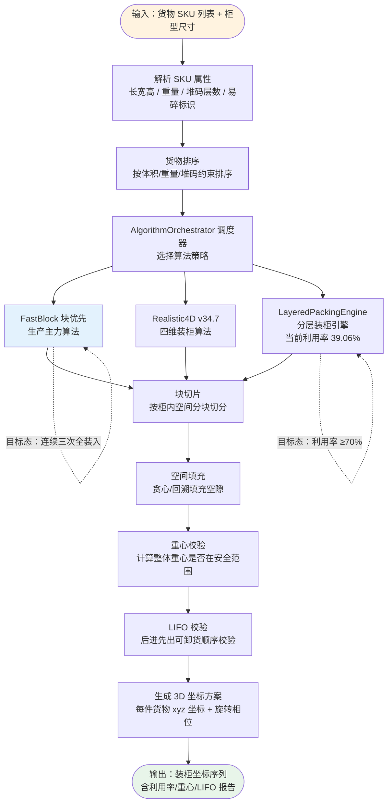

# 装箱算法流程图

> 生成时间：2026-07-11
> 文件用途：展示后端装箱算法从输入到输出的完整处理流程，包括排序、切片、填充、重心校验、LIFO 校验等关键环节。
> 说明：实线为已实现的算法步骤；虚线为目标态待补齐的增强能力。

## 算法节点说明

| 节点 | 实现方式 | 当前态 | 目标态 |
|------|----------|--------|--------|
| AlgorithmOrchestrator | 调度器选择策略 | 已实现 | — |
| FastBlock | 块优先算法 | 生产主力 | 连续三次全装入 |
| Realistic4D v34.7 | 四维装柜算法 | 已实现 | — |
| LayeredPackingEngine | 分层装柜引擎 | 利用率 39.06% | ≥70% |
| 重心校验 | 安全范围计算 | 已实现 | — |
| LIFO 校验 | 可卸货顺序 | 已实现 | — |
| 3D 坐标输出 | xyz + 旋转相位 | 已实现 | — |

## 关键约束

- 演示订单 NB2026-DEMO-01 当前 221/221 件装入，84.51% 利用率，0 件未装货物。
- 目标态要求连续三次 loaded=total, unloaded=0，需扩充数据集与算法验证。
- FastBlock 为生产主力算法，Realistic4D 与 LayeredPackingEngine 为补充策略。
