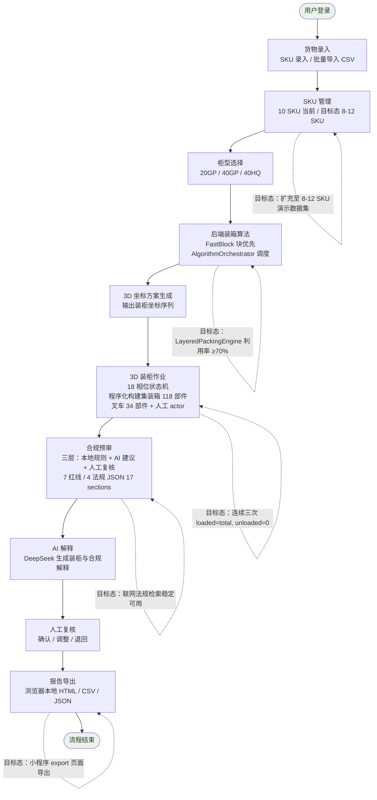

# 业务流程图

> 生成时间：2026-07-11
> 文件用途：展示甬柜易算从货物录入到报告导出的完整主链路业务流程。
> 说明：实线节点为已实现的主链路；虚线节点为比赛提交前希望完成的目标态增强。

## 主链路节点说明

| 序号 | 节点 | 当前态 | 目标态增强 |
|------|------|--------|------------|
| 1 | 货物录入 | 已实现 | — |
| 2 | SKU 管理 | 10 SKU | 8-12 SKU 演示数据集 |
| 3 | 柜型选择 | 已实现 | ≥3 目的港 2 批次（当前 3 港 1 批次） |
| 4 | 装箱算法 | FastBlock 主力 | LayeredPackingEngine ≥70% |
| 5 | 3D 坐标方案 | 已实现 | — |
| 6 | 3D 装柜作业 | 4× 倍速 | 16× 倍速 / 连续三次全装入 |
| 7 | 合规预审 | 三层已实现 | PDF 原文联动 / 联网检索稳定 |
| 8 | AI 解释 | DeepSeek 已实现 | — |
| 9 | 人工复核 | 已实现 | — |
| 10 | 报告导出 | 浏览器本地 | 后端 PDF + 小程序导出 |
