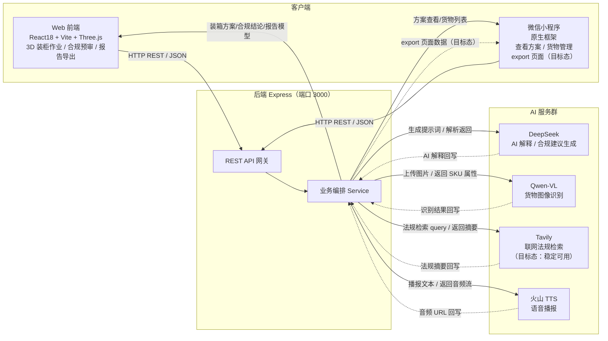

# Web、移动端、后端和 AI 关系图

> 生成时间：2026-07-11
> 文件用途：明确 Web 前端、微信小程序、后端 Express 与四类 AI 服务之间的调用关系与数据走向。
> 说明：实线为已实现的调用链路；虚线为目标态待补齐的链路。

## 调用关系说明

| 调用方 | 被调用方 | 数据内容 | 当前态 |
|--------|----------|----------|--------|
| Web 前端 | Express REST | 货物/方案/合规/报告请求 | 已实现 |
| 微信小程序 | Express REST | 方案查看/货物管理 | 已实现 |
| 微信小程序 export | Express | 报告导出数据 | 目标态 |
| 后端 Service | DeepSeek | AI 解释 / 合规建议 | 已实现 |
| 后端 Service | Qwen-VL | 货物图像识别 | 已实现 |
| 后端 Service | Tavily | 联网法规检索 | 依赖 API Key |
| 后端 Service | 火山 TTS | 语音播报 | 已实现 |

## 关键约束

- 所有 AI 调用经后端 Service 编排，前端不直连 AI 服务密钥。
- Tavily 联网法规检索当前依赖 `TAVILY_API_KEY`，稳定性为目标态。
- 小程序 export 页面当前为空壳，需在后端补齐导出端点后实现。
