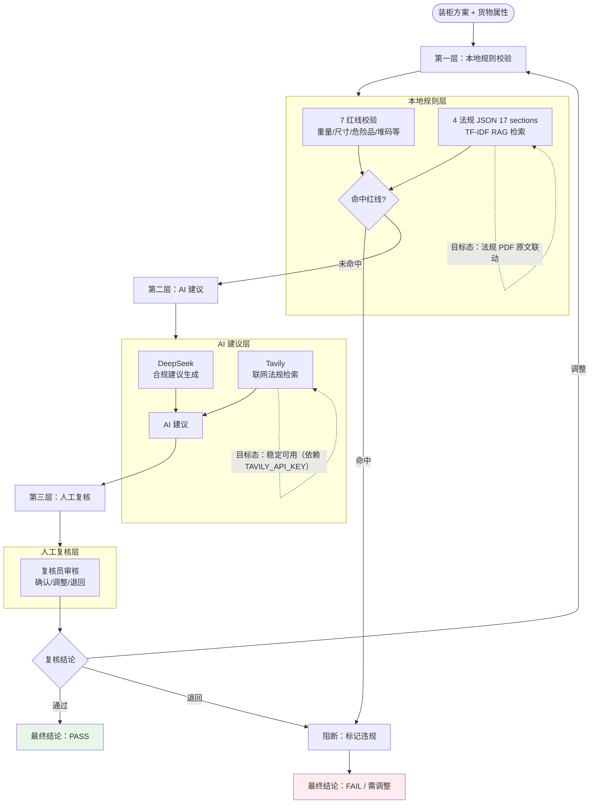

# 合规证据链流程图

> 生成时间：2026-07-11
> 文件用途：展示合规预审三层证据链（本地规则 → AI 建议 → 人工复核 → 最终结论）的完整流程。
> 说明：实线为已实现的证据链；虚线为目标态待补齐的法规 PDF 原文联动与联网检索稳定。

## 三层证据链说明

| 层级 | 模块 | 功能 | 当前态 | 目标态 |
|------|------|------|--------|--------|
| 第一层 | 7 红线校验 | 重量/尺寸/危险品/堆码阻断 | 已实现 | — |
| 第一层 | 4 法规 JSON 17 sections | 本地法规条文 | 已实现 | PDF 原文联动 |
| 第一层 | TF-IDF RAG | 法规检索匹配 | 已实现 | — |
| 第二层 | DeepSeek | 合规建议生成 | 已实现 | — |
| 第二层 | Tavily | 联网法规检索 | 依赖 API Key | 稳定可用 |
| 第三层 | 人工复核 | 确认/调整/退回 | 已实现 | — |

## 关键约束

- 三层证据链当前已实现，最终结论由人工复核确认。
- 演示订单 NB2026-DEMO-01 合规结论为 本地规则 WARNING / AI建议 PASS / 人工复核独立。
- 法规 PDF 原文联动为 NOT_FOUND，属目标态。
- 联网法规检索依赖 `TAVILY_API_KEY`，稳定性为目标态。
- 7 红线为硬阻断，命中即标记违规，不可跳过。
