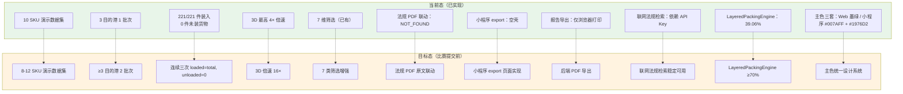

# 当前态与目标态路线图

> 生成时间：2026-07-11
> 文件用途：对照展示已实现模块（实线）与比赛提交前希望完成的目标态（虚线），明确差距与提升方向。
> 说明：实线 = 已实现；虚线 = 目标态。

## 当前态 → 目标态对照表

| 序号 | 当前态 | 目标态 | 差距说明 |
|------|--------|--------|----------|
| 1 | 10 SKU | 8-12 SKU | 需扩充演示数据集 |
| 2 | 3 港 1 批次 | ≥3 港 2 批次 | 需增加批次数据 |
| 3 | 221/221 件（0 未装） | 连续三次全装入 | 需算法验证+数据集 |
| 4 | 4× 倍速 | 16× 倍速 | 需速度档位扩展 |
| 5 | 7 维筛选已有 | 7 类筛选增强 | 需交互增强 |
| 6 | PDF 联动 NOT_FOUND | PDF 原文联动 | 需 PDF 阅读器+定位 |
| 7 | 小程序 export 空壳 | export 页面实现 | 需页面+接口 |
| 8 | 仅浏览器打印 | 后端 PDF 导出 | 需 PDF 库+端点 |
| 9 | 依赖 API Key | 稳定可用 | 需 Key 配置+稳定性测试 |
| 10 | 39.06% 利用率 | ≥70% | 需算法优化 |
| 11 | 三套主色 | 统一设计系统 | 需设计令牌对齐 |

## 优先级建议

- **P0（必须）**：连续三次全装入、后端 PDF 导出、小程序 export、主色统一
- **P1（重要）**：8-12 SKU、16× 倍速、LayeredPackingEngine ≥70%、联网检索稳定
- **P2（增强）**：≥3 港 2 批次、7 类筛选增强、法规 PDF 联动
