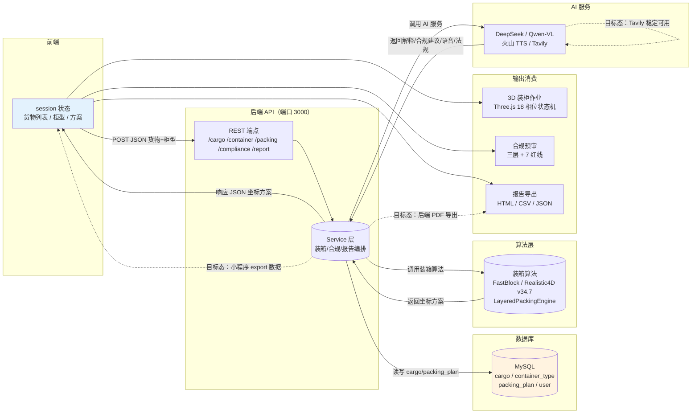

# 数据流图

> 生成时间：2026-07-11
> 文件用途：展示数据从前端 session 到后端 service、数据库，再回到 3D 渲染、合规预审、报告导出的完整流动过程。
> 说明：实线为已实现的数据流；虚线为目标态待补齐的数据流。

## 数据流节点说明

| 数据流 | 来源 | 目标 | 数据内容 | 当前态 |
|--------|------|------|----------|--------|
| 货物/柜型提交 | 前端 session | REST 端点 | JSON 货物列表+柜型 | 已实现 |
| 数据持久化 | Service | MySQL | cargo / packing_plan | 已实现 |
| 算法调用 | Service | 装箱算法 | SKU + 柜型尺寸 | 已实现 |
| AI 调用 | Service | AI 服务 | 提示词/图片/检索词 | 已实现 |
| 坐标方案响应 | Service | 前端 session | 3D 坐标 JSON | 已实现 |
| 3D 渲染 | 前端 session | Three.js | 坐标序列 | 已实现 |
| 合规预审 | 前端 session | 合规模块 | 方案+货物属性 | 已实现 |
| 报告生成 | 前端 session | 报告模块 | 报告模型 | 已实现 |
| 后端 PDF 导出 | Service | 报告模块 | PDF 二进制 | 目标态 |
| 小程序 export | Service | 小程序 | 报告数据 | 目标态 |

## 关键约束

- 前端 session 为数据中转核心，所有输出消费均从 session 取数。
- 数据库仅 4 表，报告生成在浏览器本地完成，不落库。
- 后端 PDF 导出与小程序 export 为目标态，需补齐端点与页面。
