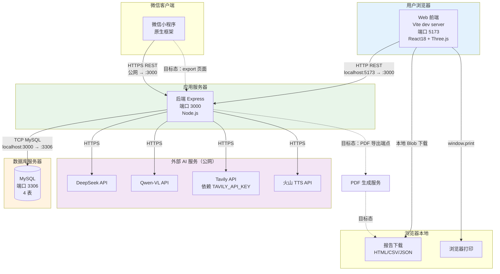

# 部署架构图

> 生成时间：2026-07-11
> 文件用途：展示甬柜易算各组件的部署位置、端口与外部依赖关系。
> 说明：实线为已实现的部署链路；虚线为目标态待补齐的部署能力。

## 部署端口与组件说明

| 组件 | 端口 | 技术栈 | 当前态 | 目标态 |
|------|------|--------|--------|--------|
| Web 前端 | 5173 | Vite dev server + React18 + Three.js | 已实现 | — |
| 后端 Express | 3000 | Node.js + Express | 已实现 | — |
| MySQL | 3306 | MySQL 4 表 | 已实现 | — |
| DeepSeek | 公网 | HTTPS API | 已实现 | — |
| Qwen-VL | 公网 | HTTPS API | 已实现 | — |
| Tavily | 公网 | HTTPS API + API Key | 依赖 Key | 稳定可用 |
| 火山 TTS | 公网 | HTTPS API | 已实现 | — |
| 报告下载 | 浏览器本地 | Blob | 已实现 | — |
| 浏览器打印 | 浏览器本地 | window.print | 已实现 | — |
| PDF 生成服务 | — | PDF 库 + 端点 | 未实现 | 目标态 |
| 小程序 export | — | 小程序页面 | 空壳 | 目标态 |

## 关键约束

- 当前为开发态部署，前端 Vite dev server 5173，后端 Express 3000。
- MySQL 4 表：cargo / container_type / packing_plan / user。
- 外部 AI 服务均经后端转发，前端不持有密钥。
- Tavily 依赖 `TAVILY_API_KEY` 环境变量，缺失时联网法规检索不可用。
- 生产部署方案（域名/HTTPS/容器化）未在仓库中确认，属于后续规划。
