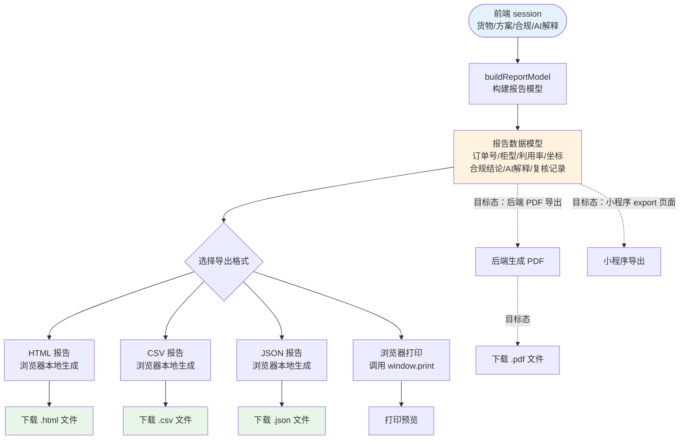

# 报告生成流程图

> 生成时间：2026-07-11
> 文件用途：展示报告从前端 session 到 buildReportModel 再到 HTML/CSV/JSON/打印的完整生成流程。
> 说明：实线为已实现的生成路径；虚线为目标态待补齐的后端 PDF 导出与小程序 export。

## 报告生成节点说明

| 节点 | 实现方式 | 当前态 | 目标态 |
|------|----------|--------|--------|
| buildReportModel | 前端构建报告数据模型 | 已实现 | — |
| HTML 报告 | 浏览器本地生成 | 已实现 | — |
| CSV 报告 | 浏览器本地生成 | 已实现 | — |
| JSON 报告 | 浏览器本地生成 | 已实现 | — |
| 浏览器打印 | window.print | 已实现 | — |
| 后端 PDF 导出 | 后端 PDF 生成库 | 未实现 | 目标态 |
| 小程序 export | 小程序页面 | 空壳 | 目标态 |

## 关键约束

- 当前报告生成全部在浏览器本地完成，不落库。
- 演示订单 NB2026-DEMO-01 报告含 221/221 件、84.51%、本地规则 WARNING / AI建议 PASS / 人工复核独立 数据。
- 后端 PDF 导出需引入 PDF 生成库与新增端点。
- 小程序 export 页面当前为空壳，需实现页面与数据接口。
- 已有样本文件：`甬柜易算装柜与合规报告-NB2026-DEMO-01.html`、`.csv`、`.json`。
