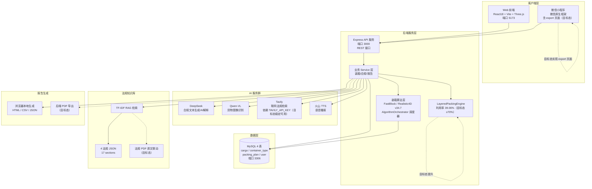

# 系统总体架构图

> 生成时间：2026-07-11
> 文件用途：展示甬柜易算系统总体分层架构，覆盖 Web 前端、微信小程序、后端服务、MySQL 数据库、AI 服务群、法规知识库六大组成。
> 说明：实线框为仓库中已确认的模块；虚线框标注"目标态"为比赛提交前希望完成但当前尚未实现的能力。

## 模块说明

| 分层 | 模块 | 当前态 | 备注 |
|------|------|--------|------|
| 客户端 | Web 前端 | 已实现 | React18 + Vite + Three.js |
| 客户端 | 微信小程序 | 部分实现 | export 页面为空壳（目标态） |
| 后端 | Express API | 已实现 | 端口 3000 |
| 后端 | 装箱算法 | 已实现 | FastBlock 主力 + Realistic4D v34.7 |
| 后端 | LayeredPackingEngine | 已实现 | 利用率 39.06%，目标态 ≥70% |
| 数据 | MySQL | 已实现 | 4 表，端口 3306 |
| AI | DeepSeek / Qwen-VL / 火山TTS | 已实现 | Tavily 依赖 API Key |
| 法规 | 4 法规 JSON + RAG | 已实现 | PDF 原文联动为目标态 |
| 报告 | 浏览器本地生成 | 已实现 | 后端 PDF 导出为目标态 |
