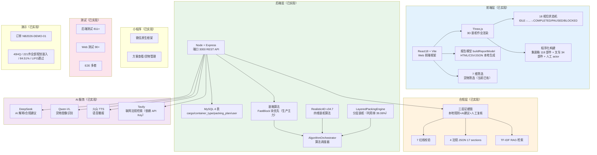

# 项目技术路线图（当前态已实现模块）

> 生成时间：2026-07-11
> 文件用途：展示甬柜易算当前已实现的技术模块与能力分布，作为比赛提交的当前态基线。
> 说明：本图仅包含仓库中已确认实现的模块，不包含目标态。

## 已实现模块清单

| 层级 | 模块 | 技术栈/参数 | 状态 |
|------|------|-------------|------|
| 前端 | Web 框架 | React18 + Vite | 已实现 |
| 前端 | 3D 渲染 | Three.js | 已实现 |
| 前端 | 状态机 | 18 相位 | 已实现 |
| 前端 | 程序化构建 | 118+34 部件 + actor | 已实现 |
| 前端 | 报告模型 | buildReportModel | 已实现 |
| 后端 | API | Express 3000 | 已实现 |
| 后端 | 数据库 | MySQL 4 表 | 已实现 |
| 后端 | 算法 | FastBlock + Realistic4D + Orchestrator + LPE | 已实现 |
| 合规 | 证据链 | 三层 + 7 红线 + 4 JSON + RAG | 已实现 |
| AI | 服务群 | DeepSeek + Qwen-VL + TTS + Tavily | 已实现 |
| 小程序 | 基础 | 微信原生 + 方案查看 | 已实现 |
| 测试 | 覆盖 | 后端 811+ / Web 90+ / E2E | 已实现 |
| 演示 | 订单 | NB2026-DEMO-01 | 已实现 |
