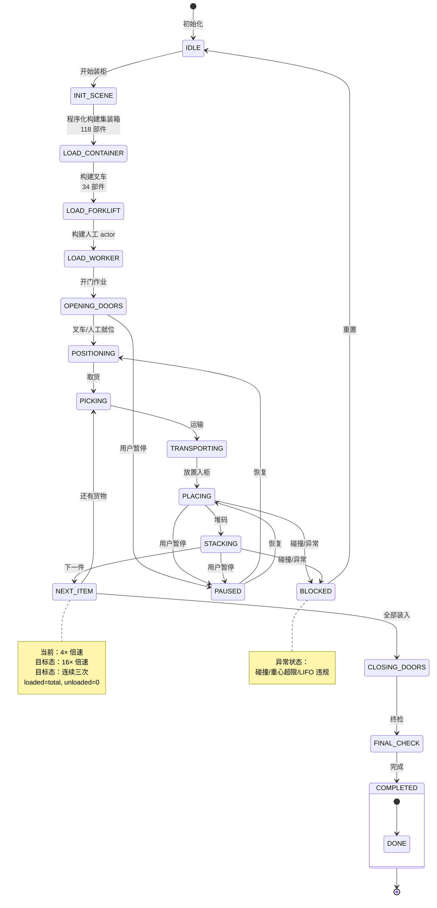

# 3D 作业状态机图

> 生成时间：2026-07-11
> 文件用途：展示 3D 装柜作业的 18 相位状态机，覆盖从空闲到完成/暂停/阻塞的全部状态流转。
> 说明：实线为已实现的状态转移；虚线为目标态增强（16× 倍速、连续三次全装入）。

## 18 相位状态说明

| 序号 | 状态 | 说明 | 当前态 |
|------|------|------|--------|
| 1 | IDLE | 空闲初始化 | 已实现 |
| 2 | INIT_SCENE | 场景初始化 | 已实现 |
| 3 | LOAD_CONTAINER | 构建集装箱 118 部件 | 已实现 |
| 4 | LOAD_FORKLIFT | 构建叉车 34 部件 | 已实现 |
| 5 | LOAD_WORKER | 构建人工 actor | 已实现 |
| 6 | OPENING_DOORS | 开门作业 | 已实现 |
| 7 | POSITIONING | 就位 | 已实现 |
| 8 | PICKING | 取货 | 已实现 |
| 9 | TRANSPORTING | 运输 | 已实现 |
| 10 | PLACING | 放置入柜 | 已实现 |
| 11 | STACKING | 堆码 | 已实现 |
| 12 | NEXT_ITEM | 下一件循环 | 已实现 |
| 13 | CLOSING_DOORS | 关门作业 | 已实现 |
| 14 | FINAL_CHECK | 终检 | 已实现 |
| 15 | COMPLETED | 完成 | 已实现 |
| 16 | PAUSED | 暂停 | 已实现 |
| 17 | BLOCKED | 阻塞异常 | 已实现 |
| 18 | (恢复路径) | 从暂停/阻塞恢复 | 已实现 |

## 关键约束

- 18 相位状态机当前全部已实现。
- 程序化构建：集装箱 118 部件 + 叉车 34 部件 + 人工 actor。
- 当前最高 4× 倍速，目标态 16× 倍速。
- 当前演示 221/221 件装入，目标态连续三次全装入。
