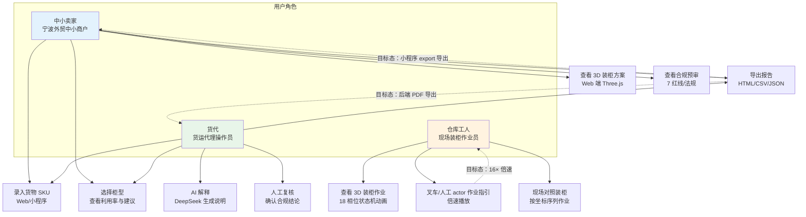

# 用户角色与使用流程图

> 生成时间：2026-07-11
> 文件用途：展示三类核心用户角色（中小卖家、货代、仓库工人）在系统中的使用流程与功能触达。
> 说明：实线为已实现的使用流程；虚线为目标态待补齐的能力。

## 角色与功能矩阵

| 功能 | 中小卖家 | 货代 | 仓库工人 | 当前态 |
|------|----------|------|----------|--------|
| 货物录入 | ✓ | ✓ | — | 已实现 |
| 柜型选择 | ✓ | ✓ | — | 已实现 |
| 3D 方案查看 | ✓ | ✓ | ✓ | 已实现 |
| 合规预审 | ✓ | ✓ | — | 已实现 |
| AI 解释 | — | ✓ | — | 已实现 |
| 人工复核 | — | ✓ | — | 已实现 |
| 报告导出 | ✓ | ✓ | — | 浏览器本地 |
| 3D 作业指引 | — | — | ✓ | 已实现 4× |
| 小程序 export | ✓ | — | — | 目标态 |
| 后端 PDF 导出 | — | ✓ | — | 目标态 |
| 16× 倍速 | — | — | ✓ | 目标态 |

## 关键约束

- 三类角色均通过 Web 或小程序访问，后端统一鉴权。
- 仓库工人核心场景为现场对照 3D 作业指引装柜。
- 小程序 export 与后端 PDF 导出为目标态，影响卖家与货代体验。
